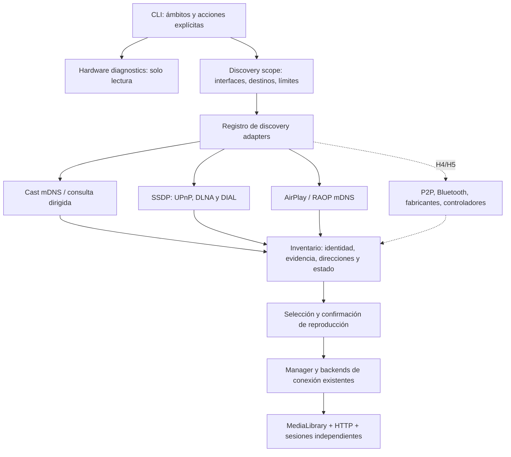

# POLTERHEIST — roadmap IoT, RF y control

<a id="plan-iot"></a>

Actualizado: **13-11-2026**. Este es el único roadmap del proyecto. Reúne IoT/RF, TV/Miracast, investigación, arquitectura y registros de validación. Se elimina la carpeta documental anterior; el paquete de código `tv_control/` conserva la compatibilidad.

Entorno objetivo confirmado por el propietario: **Kali físico**, con muchos tipos de dispositivos y uso en auditorías de radiofrecuencia. Se ejecutan en Windows todas las pruebas posibles sin ese hardware. No se restringe la arquitectura a una marca; cada familia tendrá un adaptador y una matriz de validación.


## Entrega actual — búsqueda automática y conexiones

Seleccionar **4 — IoT Scanning** inicia el análisis y después muestra la tabla y las opciones de conectar todos o IDs concretos. Los conectores no ejecutan reproducción ni acciones físicas al conectar. `YES*` indica un conector implementado cuyo éxito debe comprobarse; `LIMITED*`, una prueba MQTT/TCP que cierra; `NO`, ausencia de conector o una observación caducada. El resultado de cada intento queda en el reporte.

LAN: Cast, UPnP/DLNA/DIAL, AirPlay/RAOP, IoT DNS-SD, ONVIF y CoAP según backends habilitados. Radio: Wi-Fi Direct mediante Linux D-Bus y BLE mediante Bleak. Una LAN ausente o una fuente no disponible no impide intentar las demás. El escaneo BLE se pospone cuando hay sesiones GATT propias activas; desconectar con **9** antes de volver a buscar. Wi-Fi Direct conserva las comprobaciones de coexistencia y no desconecta redes existentes.

`bash setup.sh` prepara el entorno y ejecuta la aplicación. `bash setup.sh --run-only` reutiliza el entorno sin instalar. `--install-system` solicita expresamente dependencias APT, incluyendo BlueZ y herramientas Wi-Fi; `--no-run` prepara sin arrancar. No hace falta activar/desactivar el entorno: se usa su intérprete directamente. Nunca se ejecuta `sudo pip`. No se ha ejecutado una instalación real durante esta entrega.

**Límites pendientes:** IPv6 y múltiples interfaces LAN, commissioning Matter/HomeKit, APIs autenticadas de fabricantes, Zigbee/Thread/Z-Wave/SDR, conexión Miracast y aceptación física Kali. Un Bluetooth convencional no permite descubrir todas las familias RF. Tampoco se accede automáticamente a otras redes Wi-Fi ni a sus dispositivos internos. El roadmap sigue abierto en esas filas.

Validación automatizada de esta entrega: consultar [guía IoT](docs/IOT_CONTROL.md#pruebas-en-windows--12-11-2026) y `reports/tv_control/iot_survey_regression_windows.txt`. Los números de los anexos son históricos y no sustituyen ese registro actual.

## Índice de documentación consolidada

- [Plan IoT/RF y tareas pendientes](#plan-iot).
- [Hitos TV/Miracast](#tv-miracast).
- [Investigación H1 y matrices de fabricantes](#h1-investigacion).
- [Arquitectura del motor](#arquitectura).
- [Validación H2/H3](#h2-h3-validacion).
- [Investigación H4 / Wi-Fi Direct](#h4-investigacion).
- [Validación H4 y comandos Kali](#h4-validacion).

## Objetivo y definición de terminado

Descubrir la mayor variedad técnicamente observable de dispositivos propios, identificar su tipo con evidencia y ofrecer conexiones compatibles con su autenticación. «Detect all» significa consultar las fuentes soportadas del ámbito seleccionado: ningún escáner puede garantizar todos los dispositivos silenciosos, aislados, apagados, detrás de un hub o de una nube.

Cada tarea se cierra por separado en **código**, **pruebas automatizadas** y **validación física**. Una respuesta de red no confirma identidad física; un socket abierto no confirma autorización; un firmware coincidente con una CVE no confirma explotación. Los fixtures permanecen identificados como SIMULATED. No se marcará el roadmap completo por haber escrito interfaces vacías o por alcanzar un límite de sesión.

Orden de ejecución: cerrar F0, completar protocolos independientes en F1/F2, añadir los conectores correspondientes en F3 y realizar evaluación de seguridad F4/F5 sobre objetivos concretos. Los trabajos sin hardware pueden avanzar mientras se espera información del laboratorio. Registrar cambios, pruebas y bloqueos al final del documento.

## F0 — Inventario y experiencia de uso

- [x] Renombrar opción principal 4 a **IoT Scanning**, conservar `--tv-control` y añadir `--iot-scan`.
- [x] Al entrar en **IoT Scanning**, analizar automáticamente la LAN seleccionada, los PHY Wi-Fi Direct elegibles y los adaptadores BLE disponibles; conservar resultados parciales si falla una fuente.
- [x] Mostrar tabla de ID, nombre, tipo, dirección y posibilidad de conexión, con explicación de las limitaciones.
- [x] Tras la tabla: **1 — Connect to all detected devices** y **2 — Connect to selected devices**, mediante IDs separados por comas; validar toda la selección antes de conectar.
- [x] Aislar errores por dispositivo; cerrar conexiones propias al salir o mediante la opción 9.
- [x] Consolidar todos los planes e históricos en `ROADMAP.md`, sin `docs/tv_engine` ni un segundo roadmap IoT.
- [x] Añadir `setup.sh`: crear/reutilizar venv Linux, preservar venv Windows, instalar requirements con su Python y ejecutar; APT solo mediante `--install-system`.
- [x] Mostrar nombre, dirección, tipo anunciado, protocolos y opciones de conexión/control.
- [x] Conservar Cast/DLNA, P2P/WFD, selección de adaptador y menús anteriores dentro de Media control.
- [x] Estados separados: detectado, caché, TCP alcanzable, autenticación pendiente, controlador disponible y sesión verificada.
- [x] Límites por backend, timestamps, errores parciales, cierre de recursos y reportes locales.
- [x] Mantener configuración anterior; las listas personalizadas de backends no se sobrescriben.
- [ ] Completar regresión de esta ampliación y documentar el bloqueo de DLL de zeroconf observado en Windows, sin modificar políticas del sistema.
- [ ] Validar navegación y resultados reales en Kali y Windows con equipos propios.

## F1 — Cobertura IP y evidencia

| Trabajo | Código actual | Criterio de cierre restante |
| --- | --- | --- |
| Cast, AirPlay/RAOP, SSDP/UPnP/DLNA/DIAL | Existente | Receptores físicos y scopes enrutados autorizados. |
| DNS-SD IoT: HomeKit, Matter, Shelly, ESPHome, Home Assistant, impresión, MQTT y HTTP(S) | Implementado en esta ampliación | Regresión y equipos reales; registrar anuncios ausentes o incompatibles. |
| ONVIF / WS-Discovery | Implementado en esta ampliación | Cámara/NVR propios, variantes de respuesta y autenticación real. |
| CoAP / CoRE `.well-known/core` | Discovery IPv4 implementado y probado en loopback | Recursos/enlaces y rechazos registrados; completar block-wise, DTLS/OSCORE, IPv6 y equipos físicos. No se invocan recursos de actuación al descubrir. |
| OCF/IoTivity | Pendiente | Documentar versión y formatos; inventario de tipos de recursos sin confundirlos con dispositivos físicos. |
| Neighbor/ARP/NDP y DHCP/mDNS pasivo | Pendiente | Importar evidencia local o capturas propias; un host genérico no se etiqueta IoT por OUI/nombre. |
| IPv6 real y múltiples interfaces | Parcial: metadatos AAAA | Selección de interfaz/scope ID, sockets IPv6, multicast, deduplicación y pruebas de enlace local. |
| Redes segmentadas | Discovery dirigido parcial | Rutas existentes, ámbito explícito y límites; no crear relays/firewall/rutas automáticamente. |
| DISCO por adaptadores adicionales | Pendiente | IPP/eSCL, BACnet/IP, KNXnet/IP y otros protocolos documentados según equipos disponibles; separarlos del escaneo doméstico predeterminado. |

No se instalarán herramientas ni se activarán nuevos servicios para cubrir una casilla sin autorización. Cada backend nuevo debe aportar protocolo verificable, presupuesto de tráfico/tiempo y cancelación. Los gateways y brokers se inventarían como tales: no se inventa una lista de sus accesorios subordinados.

## F2 — Cobertura de radio y ecosistemas

- [x] Wi-Fi Direct: inventario físico/PHY, Find/StopFind, WFD y coexistencia; pendiente validación física H4.
- [x] BLE básico: enumeración de adaptadores Linux o adaptador predeterminado Windows, escaneo finito con Bleak, dirección/RSSI/manufacturer data y UUIDs; pruebas SIMULATED y cleanup. No fusionar direcciones privadas rotatorias.
- [ ] BLE ampliado: service data, capacidades físicas y validación de varios adaptadores/controladores; hardware real pendiente.
- [x] BLE GATT básico: conexión a la observación seleccionada, enumeración de UUIDs de servicios, sesiones propias y desconexión, con un único bucle async; sin pairing automático.
- [ ] BLE GATT ampliado: propiedades/características, bonding y lecturas autenticadas por dispositivo; validación física y reconexión.
- [ ] HomeKit sobre BLE y Matter commissioning por BLE: adoptar implementaciones mantenidas, sin reescribir criptografía.
- [ ] Zigbee: coordinador propio compatible, consulta de inventario y enlace autorizado; no habilitar join ni cambiar canales automáticamente.
- [ ] Thread/Matter: border router propio, credenciales de fabric y commissioning normal; validar IPv6.
- [ ] Z-Wave: controlador propio, inventario y S2/SmartStart según autorización y capacidades.
- [ ] Otros RF/IR: documentar hardware, frecuencia y protocolo antes de implementar; separar recepción de transmisión.
- [ ] Registrar capacidades reales del adaptador, ausencia de hardware, restricciones de canal y restauración tras cada sesión.

### Auditoría RF y SDR

- [ ] Contrato común de captura: dispositivo/serial, interfaz, frecuencias permitidas por hardware, frecuencia central, tasa de muestreo, ancho de banda, ganancia, duración y límites de almacenamiento.
- [ ] Inventario de receptores SDR y adaptadores especializados mediante APIs mantenidas, con estados explícitos de driver ausente, equipo ocupado y permisos insuficientes. No confundir un adaptador Wi-Fi con una radio universal.
- [ ] Importación offline de capturas I/Q y de protocolos, con hash, metadatos y parsers acotados; archivos grandes en reports, fuera de Git.
- [ ] Recepción y decodificación de beacons/telemetría propios según protocolo; conservar desconocidos sin inventar tipo por potencia/frecuencia.
- [ ] Integraciones de herramientas RF por adaptador revisado: versiones, licencia, formato de salida, proceso propio, presupuesto y limpieza. No instalar ni descargar/ejecutar plugins automáticamente.
- [ ] Evidencia de canal/modulación y correlación temporal, separada de la identidad del dispositivo y de cualquier sesión autenticada.
- [ ] Para pruebas de replay o debilidades RF, definir primero el protocolo/dispositivo de laboratorio, estado seguro, efectos y criterio de recuperación; ninguna retransmisión se activa desde discovery.
- [ ] Matriz de RX/TX por hardware y protocolo; no declarar transmisión o control disponibles por detectar señal.

## F3 — Técnicas de conexión y control

| Técnica | Implementación / siguiente acción | Evidencia necesaria |
| --- | --- | --- |
| TCP sobre servicio anunciado | Implementado; hasta cuatro puertos, ocho segundos, sin payload de aplicación | Reachability fechada; no promover automáticamente a autenticado. |
| Web HTTP(S) | Mostrar URL literal anunciada; pendiente sesión autenticada y diagnóstico TLS | Respuesta del servicio, certificados y credenciales proporcionadas por el propietario. |
| MQTT | CONNECT/CONNACK/DISCONNECT 3.1.1 implementado, sesión limpia anónima seleccionada y TLS con verificación | Completar credenciales, CA/hostname, MQTT 5 y ACL en un tópico de laboratorio; aceptación no demuestra permisos sobre tópicos. |
| Shelly / ESPHome | Discovery implementado; pendiente lectura de identidad/capacidades y cliente oficial | Modelo/API, autenticación o clave de cifrado, recursos disponibles. |
| Hue / bridges y Home Assistant | Discovery parcial; pendiente registro/token autorizado e inventario de entidades | Botón de enlace/OAuth/token del propietario; no exponer secretos en logs. |
| HomeKit | Discovery y categoría; pendiente pairing normal con cliente mantenido | Código de emparejamiento, permisos y cierre de sesión. |
| Matter | Discovery; pendiente commissioning/control mediante SDK mantenido | Setup code, fabric y endpoint/cluster reales. |
| ONVIF / RTSP | Discovery; pendiente GetDeviceInformation/GetCapabilities autenticados y visualización solicitada | Credenciales propias, perfiles/URI aprobados, parada de streams. |
| IPP / impresoras | Discovery; pendiente consulta de atributos | Separar consulta de envío de trabajos; impresión solo como acción seleccionada. |
| BLE / GATT | Conexión y servicios implementados con Bleak; escaneo necesario antes de conectar | Dispositivo real, permisos y desconexión; no se escriben características. |
| Cast / DLNA | Conexión seleccionada sin iniciar medios y control existente | Aceptación física, formatos, errores y reproducción/parada. |
| Miracast | Preparación existente | Completar H4.3/H4.4 con stack instalado/revisado y receptor propio. |
| APIs de fabricantes/nube | Pendiente, por modelo | API oficial, autenticación y alcance; no asumir compatibilidad por fabricante. |

`connections.py` separa las conexiones IoT de `Endpoint.controllable`, que sigue significando reproducción multimedia. Hay sesiones BLE/Cast, disponibilidad de protocolo DLNA y comprobaciones MQTT/TCP que cierran después de verificar. Completar una interfaz de controlador con autenticación por protocolo. Añadir capacidades por acción (`read_state`, `switch`, `set_level`, `stream`, etc.), estado de sesión y credenciales efímeras. Los dispositivos de cerraduras, puertas, calefacción y otras actuaciones físicas deben mostrar la acción concreta antes de ejecutarla.

## F4 — Evaluación de exposición y vulnerabilidades de protocolo

- [ ] Completar hallazgos estructurados con firmware, CVE, referencias y remediación. Base implementada: observaciones de HTTP anunciado y MQTT anónimo, con evidencia y límites; sin atribuir CVEs.
- [ ] Distinguir **exposición**, **configuración débil**, **CVE potencial**, **vulnerabilidad reproducida** y **no concluyente**.
- [ ] Consultar advisories del fabricante y registros CVE usando modelo/versión corroborados; no inferir vulnerabilidad únicamente por un puerto abierto o nombre.
- [ ] HTTP/TLS: verificar certificado, cifrado y autenticación de recursos de consulta documentados; no ignorar errores de certificado para obtener un resultado positivo.
- [x] MQTT: comprobar aceptación anónima seleccionada con simulador, sin publicación/suscripción; registrar rechazo y cierre.
- [ ] MQTT: validación física y ACL con un tópico de laboratorio acordado. Una conexión aceptada no demuestra lectura/publicación arbitraria.
- [ ] CoAP: comprobar exposición de discovery y lecturas permitidas; separar recursos públicos de recursos que deberían exigir DTLS/OSCORE.
- [ ] UPnP: inventariar servicios/acciones expuestos y comprobar aislamiento desde segmentos propios; no ejecutar cambios de NAT, configuración o reinicios al descubrir.
- [ ] ONVIF/RTSP: comparar operaciones públicas documentadas con operaciones protegidas usando cuentas propias; no considerar toda respuesta sin credenciales un bypass.
- [ ] BLE: evaluar flags y permisos GATT en dispositivos propios, diferenciando metadatos públicos de datos protegidos.
- [ ] Pairing: verificar que PIN, botones, códigos y ventanas de autorización se respetan y que un rechazo no provoca un fallback que evite la autorización.

## F5 — Reproducción controlada de fallos conocidos

Esta fase incluye pruebas de concepto y aprovechamiento acotado de vulnerabilidades de protocolo **en el laboratorio propio**, una vez identificados modelo, firmware, versión vulnerable, alcance y mecanismo de recuperación. No se ejecutan exploits como parte de «Detect all».

- [ ] Para cada fallo seleccionado, documentar advisory, precondiciones, comprobación mínima, efectos posibles y cómo verificar la corrección.
- [ ] Preferir primero una prueba no destructiva y guardar la evidencia exacta de aceptación/rechazo.
- [ ] Si la comprobación modifica estado, preparar backup/estado previo, operación concreta y recuperación antes de ejecutarla; las restricciones vigentes sobre instalaciones/configuración siguen aplicando.
- [ ] Añadir primero un simulador/regresión local del comportamiento vulnerable y del corregido.
- [ ] Ejecutar en un objetivo individual explícito, con límites de tráfico/tiempo y parada; registrar resultado y restauración. No convertirlo en explotación automática de cualquier equipo descubierto.
- [ ] Repetir tras actualizar/parchear y producir un informe reproducible que no almacene secretos.

No se elige ahora una CVE o payload específico: todavía no se han facilitado modelos/firmwares del laboratorio. Ese dato determina qué comprobaciones son pertinentes y cuáles podrían afectar al funcionamiento del equipo.

## F6 — Pruebas, entrega y criterios de aceptación

- [ ] Matriz por backend: parser válido/malformado, no respuesta, permiso denegado, autenticación requerida/rechazada, timeout, cancelación y limpieza.
- [ ] Pruebas de límites y seguridad de entrada: XML/JSON/TXT, URLs, redirecciones, targets fuera de scope, tamaño de paquetes y salidas.
- [ ] Regresión H1–H4, menús, configuración y medios.
- [ ] Simuladores locales para cada conector, separados de las pruebas físicas.
- [ ] Matriz física: SO/kernel, adaptador/driver, marca/modelo/firmware, protocolo, discovery, conexión, control, fallo y limpieza.
- [ ] Reporte exportable de capacidades/hallazgos; credenciales fuera del repositorio y de los logs.
- [x] Documentar dependencias exactas y comandos de ejecución por entorno, incluido `bleak==3.1.0` y `setup.sh`.
- [ ] Actualizar estado de cada fila, evidencia y próximo bloqueo después de cada entrega.

## Registro de ejecución

### 13-11-2026 — búsqueda automática, conexiones y preparación Kali

- Eliminados `docs/tv_engine/` y el roadmap IoT duplicado; los cinco documentos históricos se conservan en los anexos de este fichero, con sus referencias actualizadas.
- Al seleccionar IoT se ejecutan las fuentes disponibles de LAN, Wi-Fi Direct y BLE. Tabla de conexión y opciones **1/todos** y **2/IDs separados por comas**, con validación completa de la selección y resultados por dispositivo.
- BLE/GATT básico implementado con Bleak 3.1.0; Cast/DLNA conservados. TCP y MQTT quedan etiquetados como comprobaciones limitadas que cierran su conexión. No hay controladores universales ni commissioning nuevo.
- `setup.sh` crea/reutiliza venv y ejecuta con su intérprete; APT requiere `--install-system`. Pruebas del instalador mediante Bash y herramientas SIMULATED; no se instalaron paquetes en este host.
- Última regresión Windows (12-11): **354 pruebas, 347 correctas, seis errores de DLL zeroconf bloqueada por Application Control y una omitida por Nmap ausente**. Las **61 pruebas IoT y nueve del instalador** pasan. Log local: `reports/tv_control/iot_survey_regression_windows.txt`.
- Cierre: Ruff/formato correctos (46 archivos), 38 referencias locales válidas, sintaxis Bash y diff correctos. Nueve pruebas de setup repetidas tras verificar también la versión del intérprete de una venv reutilizada.
- Pendientes reales: validación física Kali/radios/dispositivos, desbloqueo autorizado del entorno Windows, IPv6/múltiples LAN, conectores autenticados y las familias RF aún no implementadas. Las tareas F0–F6 conservan sus casillas pendientes; no se declara terminado el roadmap completo.

### 12-11-2026 — ampliación inicial en curso

Código escrito: menú IoT, 16 tipos DNS-SD, ONVIF, clasificación por evidencia, inspección y TCP manual. Se conservan los módulos TV/P2P. Pruebas nuevas incluyen un servidor UDP ONVIF y un servidor TCP, ambos en loopback; no se ha escaneado una red física en esta ampliación.

Primera ejecución: detectó un puerto ONVIF cero tratado incorrectamente como puerto por defecto; corregido y con regresión. La importación de zeroconf produjo de nuevo un bloqueo de DLL por Windows Application Control; no se han cambiado políticas ni reinstalado paquetes. Resultado definitivo pendiente de cerrar la suite.

El propietario confirmó Kali físico y auditorías RF de múltiples familias. No hay todavía un inventario físico accesible desde este workspace; modelo/firmware/identificador concretos se recogerán al ejecutar en ese laboratorio. No se ha elegido ni ejecutado un exploit contra objetivos reales.

### 12-11-2026 — primera iteración implementada

- 42 pruebas IoT correctas; TCP, ONVIF, CoAP y MQTT incluyen servidores loopback reales. DNS-SD unitario usa transporte SIMULATED.
- Regresión completa: **326 pruebas, 319 correctas, seis errores de carga de DLL zeroconf y una omitida por Nmap ausente**; 134,253 segundos. La regresión no se marca cerrada ni verde.
- Los errores remanentes están en pruebas Cast/AirPlay anteriores y derivan de Windows Application Control. Resolver el entorno de dependencias de forma autorizada o ejecutar la suite en Kali es requisito para cerrar F0.
- Guía, contratos, límites y reporte: [docs/IOT_CONTROL.md](docs/IOT_CONTROL.md). Log de regresión local: `reports/tv_control/iot_regression_windows.txt`.
- Ruff/formato (41 archivos), comprobación de diff y dependencias correctos. Menú real `--iot-scan` abre/cierra en Windows sin escanear.
- Siguiente trabajo: cerrar el bloqueo de dependencias de F0; inventario del hardware Kali para seleccionar la implementación BLE/RF y los conectores autenticados. El roadmap sigue abierto: no están implementados los controladores de todas las familias ni hay validación física.


<a id="tv-miracast"></a>

## Hitos TV/Miracast


Updated **2026-11-12**. Implemented code, automated validation and physical interoperability are separate milestones.

| Milestone | Current delivery | Remaining validation/work |
| --- | --- | --- |
| H1 — Research | Protocol/vendor matrices and architecture. [H4 research update](ROADMAP.md#h4-investigacion). | Recheck versions and effects before adopting an external Miracast stack. |
| H2 — Hardware | Read-only Kali diagnosis, including Wi-Fi PHYs, P2P, BlueZ and media prerequisites. | Execute on physical Kali hardware; advertised capability is not a working session. |
| H3 — IP discovery | Cast, UPnP/DLNA/DIAL, AirPlay/RAOP and explicit routed IPv4 scopes. | Physical receivers, routed media return path and IPv6 transport. |
| H4.1 — P2P discovery | NetworkManager and explicitly selected supplicant D-Bus backends, physical-interface/PHY selection, bounded Find/StopFind, cancellation, state comparison and reports. | Exercise real radios/drivers, permissions, coexistence and cleanup on Kali. |
| H4.2 — Classification | Strict WFD subelement parsing, sink/source/P2P-only distinctions, freshness/cache evidence and scoped inventory. | Compare advertisements with receiver model/firmware and actual acceptance. |
| H4.3 — Miracast connection | External-stack research and preparation adapter; dependency/effects/blocker report. | **Not functional/validated:** review installed stack and approve required changes, then implement/validate pairing, connection, RTSP/RTP and teardown on hardware. No full Miracast stack rewritten. |
| H4.4 — Miracast media | Image/video selection and a separately confirmed local looping presentation process, suitable for a future screen-mirroring session. | **Not functional/validated on a receiver:** wire an authorized Miracast session to capture/presentation and verify picture/sound/stop physically. |
| H4.5–H4.8 | Multiple PHYs, interference guards, explicit errors, CLI integration and automated tests. | Driver-specific coexistence and physical failure testing. See [H4 validation](ROADMAP.md#h4-validacion). |
| H5 — Vendors | Research only. | Official pairing and supported vendor/control-platform APIs. |
| H6 — Media expansion | Existing Cast/DLNA image/video sessions retained. | New audio, RTSP/RTP, capture and transport implementations. |
| H7 — Intelligence | Conservative inventory and protocol identities. | Verified correlation, secure capability cache and path selection. |
| H8 — Hardware acceptance | Automated regressions and labeled simulators. | Physical Kali/receiver matrix; no compatibility claims based on fixtures. |

Next step: run H4.1/H4.2 on physical Kali with an authorized WFD receiver in its screen-mirroring discovery mode. Use the evidence to choose and approve an installed Miracast stack before activation. This delivery does not install packages, start external casting tools, change firewall/routes or disconnect existing networks.


<a id="h1-investigacion"></a>

## Archivo: RESEARCH

> Documento histórico conservado íntegro salvo referencias y navegación. Sus versiones, cifras y decisiones corresponden a su fase; el alcance y menú vigentes figuran al inicio de este roadmap.

### H1 — Universal TV Discovery: investigación y matriz de tecnologías

Fecha de consulta: **11 de noviembre de 2026**. Entorno objetivo: Kali Linux Live en hardware físico. Este documento distingue especificaciones, implementaciones de sus autores e inferencias de diseño. Las afirmaciones de compatibilidad de proyectos externos no son pruebas realizadas en el laboratorio POLTERHEIST.

Este documento conserva el alcance de H1. La continuación solicitada el **12-11-2026** implementa H4.1/H4.2 y prepara H4.3/H4.4: [investigación actualizada](ROADMAP.md#h4-investigacion) y [estado/validación](ROADMAP.md#h4-validacion). La revisión actual encontró una API D-Bus Manager en GNOME Network Displays; su disponibilidad debe verificarse en la versión instalada de Kali.

#### Conclusión y alcance de esta entrega

No existe un transporte universal que permita emitir vídeo a cualquier TV cercana. Sin compartir punto de acceso hay tres rutas distintas: IP enrutada con autorización y conectividad, un enlace directo soportado por ambos extremos, o una pasarela del propietario. Descubrir un anuncio no establece ninguna de esas rutas ni concede permiso de control.

H1 entrega esta matriz y la [arquitectura propuesta](ROADMAP.md#arquitectura). H2 implementa diagnóstico local de solo lectura. H3 amplía el inventario de red con Cast, UPnP/DLNA, DIAL, AirPlay/RAOP y destinos IP/hostname/CIDR explícitos y pequeños. **H4–H8 quedan pendientes de validación del usuario**, incluyendo establecimiento P2P, Miracast, nuevos controles de fabricantes, audio, RTSP/RTP, integraciones autenticadas y caché persistente de capacidades. Las pruebas de H2/H3 se realizan ahora; esto no declara completada la validación física H8.

#### Matriz de descubrimiento y transporte

| Tecnología | Evidencia que aporta / transporte | Alcance y autorización | Actividad y límites | Decisión |
| --- | --- | --- | --- | --- |
| mDNS / DNS-SD / Zeroconf | PTR identifica instancias; SRV puerto/host; TXT metadatos; A/AAAA direcciones. No es transporte multimedia. | Enlace local IPv4/IPv6; no implica permiso. | Las consultas son activas. Escuchar anuncios ya emitidos puede ser pasivo. TTL y desaparición importan. | Base de H3. [RFC 6762](https://datatracker.ietf.org/doc/html/rfc6762), [RFC 6763](https://datatracker.ietf.org/doc/html/rfc6763). |
| SSDP / UPnP | Respuestas M-SEARCH y anuncios NOTIFY; LOCATION conduce a descripción XML y servicios. | Multicast local; variantes IPv6; HTTP de descripción accesible. | M-SEARCH es activo. Un puerto abierto no confirma UPnP; validar XML, origen y URLs. | H3 reutiliza una búsqueda acotada para identificar servicios. [UPnP Device Architecture](https://upnp.org/specs/arch/UPnP-arch-DeviceArchitecture-v2.0-20140901.pdf). |
| DLNA / UPnP AV | MediaRenderer + AVTransport + ConnectionManager; SOAP para control y HTTP para contenido. | Red IP alcanzable; políticas y formatos del receptor. | MediaServer no es MediaRenderer; MIME anunciado no garantiza códec. | Conservar backend actual y sus restricciones explícitas. [AVTransport](https://upnp.org/specs/av/UPnP-av-AVTransport-v1-Service.pdf), [ConnectionManager](https://www.upnp.org/specs/av/UPnP-av-ConnectionManager-v3-Service-20101231.pdf). |
| Google Cast | `_googlecast._tcp`; canal de control Cast y app receptora; URL HTTP de contenido. | LAN o ruta autorizada que permita control y retorno HTTP. | Nombre/modelo/capacidades anunciados; receptores solo audio existen. | Preservar PyChromecast; alcance enrutado identificado separadamente. [PyChromecast](https://github.com/home-assistant-libs/pychromecast), [formatos Cast](https://developers.google.com/cast/docs/media). |
| DIAL | SSDP, descripción y `Application-URL`; descubrimiento/lanzamiento de aplicaciones. | HTTP alcanzable; permiso y aplicación receptora correspondiente. | DIAL no define por sí solo emisión arbitraria de archivos ni control multimedia universal. | Identificación en H3; no lanzar apps. [Especificación](https://www.dial-multiscreen.org/dial/protocol-specification), [FAQ](https://www.dial-multiscreen.org/dial/faq). |
| AirPlay | Bonjour `_airplay._tcp`; capacidades TXT; mecanismos dependientes de versión. | PIN, contraseña o autenticación según dispositivo; IP o ruta directa Apple compatible. | No asumir duplicación de pantalla Linux a partir de un anuncio. | Descubrimiento en H3; considerar pyatv tras validación. [Apple](https://support.apple.com/en-ae/guide/deployment/dep9151c4ace/web), [pyatv](https://pyatv.dev/documentation/supported_features/). |
| RAOP / AirTunes | `_raop._tcp`; audio, negociación y transporte asociados. | Autenticación y cifrado según receptor/versión. | No demuestra soporte de vídeo. pyatv documenta límites de autenticación RAOP. | Mostrar receptor de audio; control futuro. [Conceptos pyatv](https://pyatv.dev/documentation/concepts/). |
| Matter / Matter Casting | Descubrimiento DNS-SD y commissioning; clusters de reproducción, contenido y aplicaciones según tipo de dispositivo. | Fabric autorizado y commissioning aprobado; funciones opcionales y endpoints concretos. | Tener Matter para domótica no garantiza ser un Casting Video Player; no es un túnel universal de píxeles. | Investigación y futura integración explícita. [Ejemplo TV del SDK](https://project-chip.github.io/connectedhomeip-doc/examples/tv-app/README.html), [casting APIs](https://github.com/project-chip/connectedhomeip/tree/master/examples/tv-casting-app). |
| WS-Discovery | SOAP/UDP, Probe/Hello y tipos de servicios; puerto 3702. | Descubrimiento local o proxy administrado. | Muchas respuestas son impresoras/cámaras; no convertirlas en TVs por aparecer en la red. | Extensión futura de inventario, no backend de reproducción. [OASIS](https://docs.oasis-open.org/ws-dd/discovery/1.1/wsdd-discovery-1.1-spec.pdf). |
| DHCP leases | Asociaciones IP/MAC/hostname y caducidad proporcionadas por un servidor autorizado. | Solo ficheros/API que el propietario pueda leer. | Lectura pasiva de estado; no prueba presencia actual ni tipo TV. No extraer secretos del router. | Evidencia auxiliar futura. [dnsmasq](https://thekelleys.org.uk/dnsmasq/docs/dnsmasq-man.html). |
| ARP / Neighbor Discovery | Vecinos IPv4 / IPv6 del enlace; lectura de caché o consultas de resolución. | Dominio L2 local; no enumeran dispositivos detrás de un router. | Leer `ip neigh` es pasivo respecto al vecino; provocar resolución transmite. MAC del siguiente salto no identifica al TV remoto. | H2 inspecciona estado, sin barridos ARP/NDP. [ARP](https://www.rfc-editor.org/rfc/rfc826.html), [NDP](https://www.rfc-editor.org/rfc/rfc4861.html). |
| IP/hostname/CIDR dirigido | Consultas a endpoints de protocolos soportados; DNS y selección de ruta. | Alcance pequeño, explícito, confirmado; sin enumeración automática de Internet. | Resolver una IP no prueba alcance; TCP abierto no prueba protocolo. IPv6 requiere tratamiento de scope-id. | H3: IPv4 enrutado con controles; IPv6 se documenta por capacidad real, sin prometer reproducción. |
| DNS-SD unicast | PTR/SRV/TXT en dominio DNS configurado, posiblemente un Discovery Proxy. | Zona/resolver administrado y rutas hacia servicios. | Diferente de reflejar multicast; TTL y autorización del ámbito siguen siendo necesarios. | Diseñado, no implementado en H3. [RFC 8766](https://www.rfc-editor.org/rfc/rfc8766.html). |
| Reflectores/gateways mDNS | Publican o reflejan servicios entre enlaces. | Configurados por administradores; también hacen falta ACL y ruta de medios. | Un reflector no conecta redes aisladas por sí solo. Evitar bucles y filtrar servicios. | Consumir servicios solo dentro del alcance permitido; no configurar reflectores automáticamente. [Avahi](https://github.com/avahi/avahi/blob/master/man/avahi-daemon.conf.5.xml.in). |
| Home Assistant / SmartThings | Inventario, capacidades y servicios de un controlador autenticado. | Token del propietario con permisos limitados; local o nube según integración. | Estado del controlador puede ser viejo; una URL privada de Kali puede ser inaccesible desde TV/nube. | Adaptadores futuros; no se conectan cuentas en H3. [HA REST](https://contributors.home-assistant.io/core/internals/rest-api/), [SmartThings auth](https://developer.smartthings.com/docs/getting-started/authorization-and-permissions). |

#### Radio directa y emparejamiento

| Tecnología | ¿Detecta sin asociarse al AP del TV? | Qué se necesita | Límites / decisión |
| --- | --- | --- | --- |
| Wi-Fi Direct / P2P | Puede descubrir peers en búsqueda/escucha P2P, sin router compartido. | Chipset, driver, firmware, interfaz P2P y supplicant/NM compatibles; peer anunciándose. | `P2P_FIND`/`StartFind` son activos. P2P no equivale a WFD. H2 consulta capacidades; H4 establecerá un flujo consentido. [wpa_supplicant](https://w1.fi/wpa_supplicant/devel/p2p.html), [NM WifiP2P](https://networkmanager.dev/docs/api/latest/gdbus-org.freedesktop.NetworkManager.Device.WifiP2P.html). |
| Miracast / Wi-Fi Display | Sí, cuando hay anuncios WFD sobre P2P y ambos extremos son compatibles. | Negociación P2P, RTSP, RTP y códecs; captura y permisos del escritorio; HDCP en los casos que lo requieran. | No basta con detectar P2P-client/GO. `WfdIEs` aporta evidencia específica. Streaming requiere H4/H6 y hardware. [Peer NM](https://networkmanager.dev/docs/api/1.52.0/gdbus-org.freedesktop.NetworkManager.WifiP2PPeer.html). |
| WPS durante P2P | Forma parte del aprovisionamiento legítimo del enlace cuando se negocia. | Confirmación push-button o PIN y método anunciado. | No reutilizar el módulo de auditoría WPS para conectar TVs. Ningún brute force, PIN predefinido ni cambio de red existente. [P2P de wpa_supplicant](https://w1.fi/wpa_supplicant/devel/p2p.html). |
| Bluetooth Classic / SDP | Inquiry puede descubrir dispositivos en modo visible; SDP describe servicios. | Adaptador/BlueZ, permisos y, para algunos servicios, enlace o pairing. | Inquiry y consultas SDP son activos. A2DP/AVRCP son audio/control, no casting de vídeo universal. H2 enumera adaptadores y UUIDs publicados localmente. [BlueZ Adapter](https://bluez.readthedocs.io/en/latest/adapter-api/), [Device](https://bluez.readthedocs.io/en/latest/device-api/). |
| BLE advertisements / GATT | Anuncios pueden detectarse sin conexión; GATT requiere conexión para muchas consultas. | Adaptador BLE, modo de escaneo y permisos. | Escaneo activo puede emitir scan requests. GATT puede requerir cifrado/autorización. Nombre/RSSI no prueban identidad ni capacidad multimedia. Backend futuro explícito. [BlueZ GATT](https://bluez.readthedocs.io/en/latest/gatt-api/). |
| Bluetooth LE Audio / Auracast | Puede anunciar audio cercano sin AP compartido. | Funciones LE Audio y roles/perfiles específicos en ambos extremos, además de soporte del stack. | Audio, no vídeo. Un TV que emite audio no necesariamente recibe audio de Kali. No inferirlo por “Bluetooth 5.x”. [Bluetooth SIG](https://www.bluetooth.com/auracast/faq/). |
| NFC | Proximidad física; puede transferir datos de handover/emparejamiento. | Lector/etiqueta/hardware NFC y protocolos compatibles. | Auxiliar, no transporte de vídeo de largo alcance. Handover no elimina consentimiento. [NFC Forum](https://nfc-forum.org/build/specifications/connection-handover-technical-specification/). |

La escucha verdaderamente pasiva de anuncios 802.11 puede requerir monitor mode y control de canal; no se habilita en esta entrega. Una radio única puede no mantener simultáneamente managed/P2P en canales distintos. La tabla de combinaciones válidas de `iw phy` debe conservarse como evidencia. No se deben desconectar adaptadores ocupados para “mejorar” el descubrimiento.

##### Comparación Miracast actual

| Proyecto | Mantenimiento observado al consultar | API / dependencias / compatibilidad | Propuesta |
| --- | --- | --- | --- |
| GNOME Network Displays | Mirror oficial: commit [da8f4de](https://github.com/GNOME/gnome-network-displays/commit/da8f4de9e87c64c37cb2d70720d876c2b4045f98), 27-10-2026; no GitHub latest release disponible en la consulta (no significa que no existan releases en GNOME). | Se declara experimental. Aplicación C/GTK, NM/wpa_supplicant, GStreamer, portal/captura y codificadores. El README contiene pruebas por modelo y diagnóstico WFD. No asumir una API Python embebible estable. | Primer candidato para una validación manual aislada después de H3. [README](https://github.com/GNOME/gnome-network-displays). |
| FluxCast | Commit [a16ae05](https://github.com/IlyaP358/fluxcast/commit/a16ae057f7e155c7102a45045ba41b58a5df55f6), release [v0.3.0](https://github.com/IlyaP358/fluxcast/releases/tag/v0.3.0), 03-11-2026. | Implementación Python WFD; NM o wpa_supplicant, FFmpeg/GStreamer, portal o captura del compositor. El autor limita la validación principal a WFD y marca Cast experimental. El instalador puede cambiar políticas D-Bus y paquetes; algunos modos gestionan firewall. | Evaluar como proceso adaptado, fijando versión y revisando efectos del instalador antes de solicitar aprobación. No importar ni ejecutar instaladores ahora. [Repositorio](https://github.com/IlyaP358/fluxcast). |
| MiracleCast | Commit [0b7f1f1](https://github.com/albfan/miraclecast/commit/0b7f1f1f6586dc65ff480f3cda5c2170a70aa020), 10-03-2026; latest release de GitHub no disponible. | C/systemd/sd-bus, GStreamer, supplicant propio. El README indica que Display-Source no está implementado; su lado sink tiene otro objetivo. | No elegirlo como emisor Kali→TV. No parar NetworkManager para usarlo. Actividad de commits no demuestra capacidad de source. [README](https://github.com/albfan/miraclecast). |

Estas fechas proceden de consultas de solo lectura a la API pública GitHub `/repos/{owner}/{repo}/commits?per_page=1` y `/releases/latest`. Son una fotografía del mantenimiento, no una auditoría ni un benchmark comparativo. No se ha instalado ninguno de los tres proyectos.

#### Matriz de ecosistemas

| Ecosistema | Descubrimiento y transporte | Autenticación / control | Multimedia, red y límites |
| --- | --- | --- | --- |
| Samsung Tizen | SSDP/mDNS según modelo; HTTP/WebSocket de control. | Popup o PIN en modelos concretos; mantener token con almacenamiento seguro futuro. | Remote keys no equivalen a aceptar archivos; Cast, AirPlay, DLNA o Miracast son capacidades separadas. Algunos modelos imponen restricciones de subred. [Integración mantenida por HA](https://www.home-assistant.io/integrations/samsungtv/). |
| Samsung SmartThings | Inventario de nube por API HTTPS, no descubrimiento radio. | OAuth2 Bearer y scopes; PAT modernos con caducidad limitada. | Capabilities específicas; no prometer relay de un archivo HTTP local. [API/autorización oficial](https://developer.smartthings.com/docs/getting-started/authorization-and-permissions). |
| LG webOS | SSDP de segunda pantalla; WebSocket SSAP; algunos modelos anuncian otros protocolos. | Autorización visible/client key y permisos por operación. | Connect SDK publica capacidades de media/control, variables por versión; validar formatos y URL. [LG Connect SDK](https://connectsdk.com/en/latest/apis-and/and-webostvservice.html). |
| Sony Bravia | UPnP/DIAL/Cast según modelo; JSON-RPC HTTP y SOAP IRCC-IP en líneas compatibles. | PSK o registro/autenticación según API y configuración. | API de Bravia Professional no garantiza las mismas funciones en todo televisor doméstico. [Sony REST](https://pro-bravia.sony.net/remote-display-control/rest-api/structure/), [IRCC](https://pro-bravia.sony.net/remote-display-control/ircc-ip/). |
| Android TV | Cast/DIAL/servicio Remote según instalación; control TLS y pairing en bibliotecas abiertas. | PIN/certificado para Android TV Remote. ADB requiere autorización separada y no se habilita. | Lanzar apps no sustituye al receptor Cast. Fire TV no suele incluir Android TV Remote Service. [HA Android TV Remote](https://www.home-assistant.io/integrations/androidtv_remote/). |
| Google TV | Plataforma con capacidades Cast/Remote según dispositivo; no es un protocolo distinto universal. | Autorización por servicio. | Límites de formatos por generación y hardware; no asumir que todos los Android integran Cast. [Google Cast](https://developers.google.com/cast/docs/media). |
| Roku | SSDP `roku:ecp`, HTTP ECP. | Requiere ajustes de control por apps para ciertos comandos; developer mode solo para algunas operaciones. | Deep links dependen del canal/receptor; revisar restricciones actuales de uso ECP. No es un renderizador arbitrario por abrir 8060. [Roku oficial](https://developer.roku.com/docs/developer-program/debugging/external-control-api.md). |
| Apple TV | AirPlay/RAOP/Companion/MRP según tvOS; Bonjour y mecanismos Apple de proximidad. | Pairing/PIN/credenciales por protocolo. | pyatv ofrece capacidades verificables por API; no prueba soporte Linux de peer-to-peer Apple ni mirroring. [pyatv](https://pyatv.dev/documentation/supported_features/), [Apple](https://support.apple.com/en-ae/guide/deployment/dep9151c4ace/web). |
| Amazon Fire TV | DIAL y receptores/app específicos; Matter Casting según soporte. | App y commissioning autorizados; ADB no se habilita. | Fling terminó soporte estándar el 05-03-2026; Amazon recomienda Matter Casting. No elegir Fling como dependencia nueva. [Aviso oficial](https://www.developer.amazon.com/docs/fling/integrating-amazon-fling-into-your-fire-tv-app.html). |
| Philips | jointSPACE HTTP/HTTPS, SSDP y otros servicios según modelo. | API v6 requiere PIN; versiones y endpoints difieren. | 1925/1926 no bastan como prueba de compatibilidad; Android/Cast y funciones Ambilight son independientes. [HA Philips](https://www.home-assistant.io/integrations/philips_js/). |
| Hisense / VIDAA | Protocolos de TV/app, SSDP y MQTT local en algunas implementaciones comunitarias. | PIN/tokens y, en ciertos firmwares, mTLS; no hay una API pública universal verificada para toda la marca. | Parte del software abierto usa credenciales/certificados extraídos de apps. No incorporar esos mecanismos ni secretos al motor; preferir APIs del propietario o servicios estándar realmente anunciados. [Limitaciones del autor de ioBroker VIDAA](https://github.com/gcaruso73/ioBroker.vidaa). |
| Panasonic Viera | UPnP y control de app según generación. | PIN cuando el modelo requiere pairing; variantes cifradas. | Reproducción y estado varían; no convertir un servicio remote en prueba de codec. [HA Panasonic](https://www.home-assistant.io/integrations/panasonic_viera/). |
| Chromecast externo | mDNS Cast; canal de control + URL de medios. | Reglas de acceso del receptor; no eludirlas. | No necesita integrar la TV; por sí solo no da control sobre todas sus funciones. [PyChromecast](https://github.com/home-assistant-libs/pychromecast). |
| Adaptador Miracast | P2P con WFD IEs; RTSP/RTP tras enlace autorizado. | Negociación y consentimiento según equipo. | Requiere source real en Kali y codecs compatibles; puede ser opción para una TV sin red. [GNOME Network Displays](https://github.com/GNOME/gnome-network-displays). |
| DLNA genérico | SSDP/UPnP AVTransport y formatos Sink. | Políticas locales del renderer. | No asumir soporte uniforme de imágenes, pausa, repetición ni perfiles AVC. Conservar las comprobaciones actuales. [UPnP AV](https://upnp.org/specs/av/UPnP-av-AVTransport-v1-Service.pdf). |

#### Otras rutas: alcance físico y pasarelas

| Interfaz | Alcance / utilidad | Hardware y límites |
| --- | --- | --- |
| HDMI-CEC | Bus físico de control: alimentación, entrada, teclas y estado. No transporta el vídeo multimedia de la aplicación. | Adaptador/driver CEC compatible, p. ej. USB-CEC; muchos HDMI de PC no lo exponen. [libCEC](https://github.com/Pulse-Eight/libcec), [kernel](https://github.com/torvalds/linux/blob/master/Documentation/admin-guide/media/cec.rst). |
| HDMI | Salida física de imagen/audio y duplicación/extensión gestionada por escritorio/GPU. | Cable, GPU/salida y entrada TV; no es descubrimiento inalámbrico. EDID es evidencia del monitor conectado. |
| USB-C DisplayPort Alt Mode | Vídeo/audio físico a monitor/TV mediante cable/adaptador compatible. | El conector USB-C por sí solo no prueba Alt Mode; comprobar puerto, GPU, cable y adaptador. [VESA](https://vesa.org/dp-usb-type-c/). |
| Ethernet directo | Proporciona un enlace IP sin compartir Wi-Fi; permite protocolos IP si hay direccionamiento y servicios. | Puertos/adaptador/cable; una NIC conectada no configura IP por sí sola. No cambiar direcciones, DHCP ni rutas sin aprobación. |
| Receptor multimedia externo | Añade Cast, Miracast o AirPlay concreto a una entrada HDMI. | Coste/hardware adicional y capacidades del receptor real; no vuelve universal el televisor. |
| Pasarela MQTT/HTTP del propietario | Puede exponer inventario y comandos de dispositivos aislados de Kali. | API documentada, alcance, ACL, TLS y secretos en gestor seguro. MQTT es un transporte de mensajes; no define por sí solo vídeo ni semántica TV. [HA REST](https://contributors.home-assistant.io/core/internals/rest-api/). |

#### Decisiones de ingeniería y cuestiones por validar

1. Identidad estable por protocolo cuando existe; coincidencia de nombre/RSSI/fabricante nunca basta para fusionar. La coincidencia IP del inventario actual se presenta como correlación del mismo host, con confianza limitada, no identidad física certificada.
2. Conservar las capacidades anunciadas separadas de capacidades probadas. No establecer sesiones durante discovery y no afirmar `Ready for media` antes de una reproducción aceptada.
3. Una cadena Cast→DLNA→AirPlay→Miracast solo es una propuesta si todas esas rutas existen y están autorizadas. Nunca reaccionar a un rechazo de pairing probando otro mecanismo para evitarlo. El selector inteligente completo pertenece a H7.
4. La cache futura guardará evidencia, timestamps, TTL, versión del firmware y último resultado. PIN, tokens, client keys o PSK se referenciarán mediante un keyring/Secret Service; si no está disponible, pedir credenciales por sesión. No crear un “almacén cifrado” con la clave junto al fichero.
5. En Kali Live la persistencia depende del medio configurado. Diagnóstico debe funcionar con herramientas ausentes y registrar `unknown`, `missing` o `permission denied`, sin instalar paquetes automáticamente.
6. La prueba física pendiente debe comprobar interfaz/PHY concreto, coexistencia managed/P2P, receptor/modelo/firmware, pérdida de red, autorización y limpieza. Esta entrega no puede declarar Miracast funcional por una lista de capacidades de `iw`.


<a id="arquitectura"></a>

## Archivo: ARCHITECTURE

> Documento histórico conservado íntegro salvo referencias y navegación. Sus versiones, cifras y decisiones corresponden a su fase; el alcance y menú vigentes figuran al inicio de este roadmap.

### H1 — Propuesta de arquitectura y frontera H2/H3

Actualización IoT (12-11-2026): el menú raíz ahora es IoT Scanning y los controles multimedia se conservan como submenú. `iot_mdns`, `onvif` y `coap` amplían el contrato de discovery; `iot.py` separa tipo/alcanzabilidad/control, `mqtt.py` comprueba sesiones explícitas y `security.py` exporta observaciones sin afirmar CVEs. El alcance RF y las conexiones pendientes se siguen en [ROADMAP.md](ROADMAP.md#plan-iot) y [guía IoT](docs/IOT_CONTROL.md).

Actualización H4 (12-11-2026): se mantiene el diseño base descrito abajo. `p2p.py`/`wireless_bus.py` implementan adaptadores de descubrimiento radio explícitos; `wireless.py` gestiona el ciclo separado del scan IP; `wfd.py` aporta clasificación basada en anuncios. La UI funciona sin LAN IPv4. `miracast.py` prepara una integración externa y una presentación local, sin conexión Miracast activada. Véanse [investigación H4](ROADMAP.md#h4-investigacion), [validación H4](ROADMAP.md#h4-validacion) y [ROADMAP](ROADMAP.md). La puerta H2/H3 se abrió mediante la nueva tarea H4; siguen pendientes validación física e instalación/cambios autorizados.

#### Punto de partida inspeccionado

`script.py` contiene el menú y las funciones previas; `POLTERHEIST.py` importa `main`. TV Control es un paquete independiente con `Discovery`, `Endpoint`/`Device`, `Manager`/`Session`, `MediaLibrary`, `MediaServer` y dos backends de reproducción. Pruebas con unittest, formato/lint con Ruff y dependencias fijadas en `requirements.txt`. El directorio de trabajo ya contiene la implementación de la entrega anterior: se conserva, sin tratar esos cambios como descartables.

Limitaciones actuales relevantes: una interfaz IPv4, descubrimiento dirigido solo dentro de su subred, mezcla de descubrimiento y protocolo en algunos archivos, estados de inventario poco detallados y ausencia de diagnóstico global de hardware. El servidor HTTP actual sirve una dirección IPv4; anunciar una ruta enrutada no valida la ruta de retorno del contenido.

#### Separación propuesta



H2 añade `hardware.py` sin depender de una interfaz LAN utilizable. H3 añade adaptadores registrables, resolución de alcance explícito, fuentes mDNS de AirPlay/RAOP y enriquecimiento de SSDP/DIAL. Los adaptadores producen observaciones; no invocan `connect`, `play`, pairing, StartFind, Bluetooth StartDiscovery ni cambios de interfaces.

#### Contratos y evidencia

Una observación incluye protocolo, identificador con namespace, nombre/modelo anunciados, direcciones, puerto, fuente de descubrimiento, tiempo observado, evidencia de reachability y confianza. Un endpoint de control existente sigue siendo un `Endpoint`; sus campos adicionales no rompen los constructores actuales. No se marca controlable una integración solo investigada.

Los estados se muestran por dimensiones, porque no constituyen una escalera automática:

| Dimensión | Valores e interpretación |
| --- | --- |
| Descubrimiento | `DETECTED` o `UNAVAILABLE` tras actualización; solo evidencia observada. |
| Alcance | `NOT CHECKED`, `REACHABLE` por respuesta de protocolo o `UNREACHABLE`/error; nunca por nombre. |
| Compatibilidad | Backend implementado y requisitos anunciados, o `DISCOVERY ONLY`/`UNSUPPORTED`. |
| Autorización | Desconocida, anuncio de requisito o `PAIRING REQUIRED` solo con evidencia explícita. |
| Sesión | `CONNECTED`/`READY FOR MEDIA` solo cuando una sesión real informa conexión/reproducción aceptada. |
| Confianza | Anuncio, respuesta de protocolo, observación verificada localmente; incluye motivo, no porcentajes inventados. |

H3 mantiene IDs estables durante el proceso. Las asociaciones entre IPs/radios con identidad insuficiente no se fuerzan. La cache persistente, el ranking por calidad/latencia y la correlación radio inteligente son H7, no se implementan a escondidas en esta entrega.

#### Alcance y límites de red

LAN conserva interfaz seleccionada y búsqueda multicast acotada. La búsqueda dirigida acepta direcciones IPv4, hostnames resueltos una vez y CIDR pequeños. Requiere confirmación del alcance, tiene máximo de hosts antes de expandir, concurrencia limitada y no prueba rangos de puertos. Se consulta Cast y SSDP unicast donde corresponda; un televisor puede no responder a uno de estos métodos.

Para un destino externo a la subred, la selección de IP origen se obtiene de la tabla de rutas sin modificarla. Las URLs de respuesta se restringen al literal del peer aprobado; no se siguen redirecciones ni se amplía el alcance por una descripción del dispositivo. Un hostname se fija a las direcciones resueltas para evitar cambios de destino entre validación y petición.

IPv6 es explícito en el modelo/diagnóstico y en direcciones DNS-SD observadas. La primera ampliación no convierte automáticamente el servidor de medios ni todos los transportes a IPv6. Los endpoints sin ruta multimedia implementada permanecen discovery-only. DNS-SD unicast y reflectores administrados están diseñados en H1, no instalados ni configurados en H3.

#### H2: comprobaciones autorizadas

Consultar `iw dev/phy`, sysfs para IDs de chipset/controlador, `ip -j`, `nmcli` de estado, `wpa_cli get_capability`, propiedades D-Bus de wpa_supplicant, `rfkill` de estado, adaptadores/UUIDs BlueZ y herramientas multimedia. Comprobar encoders anunciados, plugins GStreamer, PipeWire y disponibilidad de portal de captura mediante propiedades, **sin iniciar captura**.

El runner utiliza argv, `shell=False`, tiempos máximos y límite de salida. Guarda estados/errores por comando; comandos desconocidos no entran en una cadena arbitraria. No usa sudo, no inicia servicios y no ejecuta escaneos de Wi-Fi/Bluetooth. Tener plugin H.264 no demuestra que el encoder hardware pueda abrir una sesión. Tener P2P no demuestra una negociación Miracast exitosa.

#### Conexión, medios e integraciones posteriores

Se conserva el motor Cast/DLNA actual. Se exige confirmación antes de iniciar cualquier reproducción, incluida una sola TV, conforme a esta nueva tarea. Las nuevas observaciones AirPlay/RAOP/DIAL no adquieren controles ficticios. Los destinos enrutados requieren validar la ruta multimedia en una fase posterior antes de usar automáticamente el servidor actual.

H4 debería implementar descubrimiento P2P con un adaptador NM D-Bus y un ciclo explícito StartFind/StopFind, comprobando radio libre/coexistencia. El establecimiento del grupo y sus cambios del sistema se someterán a autorización concreta. Se propone evaluar GNOME Network Displays/FluxCast como procesos con contrato de inicio/estado/cancelación y versión fijada, no copiar un stack RTSP sin pruebas.

H5 añadirá controladores por fabricante y almacenamiento seguro de credenciales; H6 ampliará audio, RTSP/RTP y captura; H7 seleccionará rutas elegibles. Autenticación denegada es un resultado terminal de esa acción, no una señal para evitarla con otro backend.

#### Plan de validación y puerta de revisión

Automatizar parsers de `iw`, sysfs simulado, herramientas ausentes/permisos/timeouts, mDNS AirPlay/RAOP y IPv6, XML DIAL, scopes hostname/CIDR, deduplicación y rechazo de URLs fuera de alcance. Los simuladores se identificarán como tales y solo usarán loopback. Ejecutar también las pruebas anteriores de sesiones y medios.

Entregar informe de diagnóstico con plataforma real, fuentes y limitaciones, y un registro de pruebas reproducible. En este workspace Windows solo se puede validar el comportamiento no-Linux y parsers/simuladores; las comprobaciones físicas de Kali y receptores quedan pendientes. **Después de entregar H2/H3, solicitar validación del usuario antes de H4 o de instalar dependencias importantes/cambiar configuraciones del sistema.**


<a id="h2-h3-validacion"></a>

## Archivo: VALIDATION

> Documento histórico conservado íntegro salvo referencias y navegación. Sus versiones, cifras y decisiones corresponden a su fase; el alcance y menú vigentes figuran al inicio de este roadmap.

### H2/H3 — uso, evidencia y registro de validación

Fecha: **11-11-2026**. Entrega: H1 investigado/documentado, H2 implementado y H3 implementado para descubrimiento IP. Entorno ejecutado: **Windows, Python 3.13**. No se ha ejecutado Kali físico ni probado una TV con esta ampliación. Ningún resultado simulado se incluye en el inventario de producción.

Registro histórico de H2/H3. La tarea H4 posterior autorizó continuar el desarrollo: consultar [validación y límites de H4](ROADMAP.md#h4-validacion) para el estado actual y los nuevos comandos/menús. Las cifras y la puerta de revisión de este registro corresponden a aquella entrega.

#### Entrega revisable

| Hito / backend | Implementación entregada | Límite explícito |
| --- | --- | --- |
| H1 | [Investigación y matrices](ROADMAP.md#h1-investigacion), [arquitectura](ROADMAP.md#arquitectura), fuentes oficiales/repositorios y comparación GNOME Network Displays / FluxCast / MiracleCast. | Fotografía de documentación y mantenimiento, no prueba de interoperabilidad. |
| H2 | `hardware.py`: interfaces/PHY, IDs del chipset, driver, P2P, bandas/restricciones, combinaciones simultáneas, NM/supplicant, BlueZ/UUIDs locales, FFmpeg/GStreamer, PipeWire y portal/entorno gráfico. | Consultas de solo lectura. P2P/WFD o un encoder anunciado no verifican una sesión Miracast. |
| H3 A — LAN | Registro de adaptadores Cast, SSDP/UPnP/DLNA/DIAL y Bonjour AirPlay/RAOP; evidencia, alcance, autenticación y capacidades separadas. | Transporte IPv4. AirPlay/RAOP/DIAL son observaciones sin backend de reproducción nuevo. UPnP genérico puede ser un router u otro dispositivo. |
| H3 B — enrutado | IP, hostname fijado tras resolución y CIDR pequeño; selección de ruta, confirmación del ámbito, consultas Cast y SSDP unicast. | Máximo 16 hosts por defecto, configurable hasta 64. No escanea rangos de puertos. Fuera de la LAN seleccionada no habilita playback. |
| C/D/E — P2P, Miracast, Bluetooth discovery | Diseño e investigación, diagnóstico local de prerrequisitos. | Descubrimiento activo de radio y establecimiento de enlaces pendientes de H4/validación. |
| F/G — fabricantes/controladores | Matriz y contratos de extensión. | Pairing/APIs de fabricantes, Home Assistant y SmartThings pendientes de H5. |
| H6/H7 | Conservación del motor Cast/DLNA de imágenes/vídeo, sin nuevos transportes. | Audio, RTSP/RTP, captura, cache segura, correlación entre radios y selección inteligente pendientes. |

No se han instalado nuevas dependencias ni modificado NetworkManager, radios, firewall, rutas o configuración del sistema en esta ampliación. Se reutilizan las dependencias Python existentes. Las pruebas FFmpeg usan las herramientas ya disponibles en `.venv/ffmpeg-tools`, añadiéndolas únicamente al PATH del proceso de prueba.

#### Ejecución en Kali

Desde el repositorio, con el entorno Python existente:

```bash
.venv/bin/python script.py --tv-diagnostics
.venv/bin/python script.py --tv-control
```

Si el setup anterior creó `.venv-linux`, usar `.venv-linux/bin/python`. El punto de entrada `POLTERHEIST.py` también acepta ambas opciones.

El diagnóstico no necesita conectividad LAN ni root. Consulta herramientas que ya existen y muestra `MISSING`, `ERROR`, `TIMEOUT`, `TRUNCATED` o `SKIPPED` por prueba. Permisos insuficientes quedan registrados; no ejecuta sudo ni instala herramientas. Tiene un presupuesto de 45 segundos, consultas de hasta 3 segundos y salida limitada a 128 KiB por comando, más el tiempo acotado de limpieza. Las propiedades D-Bus usan `--auto-start=no`; no se inicia captura, pairing ni búsqueda de radio. Los UUIDs BlueZ corresponden al adaptador local, no a perfiles verificados en una TV.

Guarda `reports/tv_control/hardware_<UTC>.json`. El código de salida es 0 al completar el diagnóstico Linux, aunque existan herramientas ausentes; se deben revisar los estados internos. En otras plataformas devuelve 1 y explica la limitación. Ctrl+C devuelve 130 desde la entrada CLI.

En TV Control:

1. Revisar las observaciones LAN. `COMPATIBLE BACKEND; SESSION UNTESTED` indica requisitos anunciados y backend disponible; no prueba pairing ni reproducción.
2. Usar **5 — Inspect capabilities** para consultar direcciones, fuente, evidencia, autenticación y detalles. La agrupación por IP es provisional, no una identidad física demostrada.
3. Usar **4 — Directed discovery** para una IP, hostname o CIDR autorizado, por ejemplo `192.168.50.20`, `tv.example` o `192.168.50.16/30`. Se muestran IP origen y destinos antes de pedir `y`. ENTER cancela.
4. Usar **7 — Configure discovery backends** para elegir `cast`, `upnp`, `airplay` durante la sesión. Cambia el motor de descubrimiento, sin cambiar servicios del sistema.
5. Cada búsqueda guarda `reports/tv_control/discovery_<UTC>.json`. Incluye tiempos, errores por backend, servicios y evidencia. `NO RESPONSE` no demuestra que el aparato esté apagado; puede filtrar ese protocolo.

Cada destino consulta Cast device-info y/o SSDP unicast según los backends habilitados. URLs de descripciones, SCPD y Application-URL deben permanecer en la IP literal aprobada; no se siguen redirecciones. Un destino fuera de la LAN permanece discovery-only porque no está verificada la ruta de retorno del servidor HTTP. Una actualización dirigida sin respuesta marca ausentes los dispositivos previos de ese ámbito, conservando los demás. Ctrl+C descarta trabajos pendientes y espera a que terminen las consultas acotadas ya iniciadas.

El descubrimiento multicast es activo. Una red distinta necesita una ruta autorizada que ya exista; el motor no crea túneles, reflectores ni redes P2P. Se conservan direcciones IPv6 en registros Bonjour recibidos por IPv4, pero no se descubren receptores exclusivamente IPv6. DNS-SD unicast, importación de leases y gateways autenticados están investigados, no implementados.

La reproducción conservada requiere **confirmación antes de cada inicio/cambio**, incluso con un solo dispositivo. AirPlay/RAOP/DIAL no aparecen como destinos reproducibles. RAOP no se etiqueta como vídeo. No se lanzan apps DIAL durante las búsquedas.

#### Registro de pruebas automatizadas

Comandos ejecutados en Windows con la venv existente:

```powershell
.\.venv\Scripts\python.exe -m ruff check script.py POLTERHEIST.py tv_control tests
.\.venv\Scripts\python.exe -m ruff format --check script.py POLTERHEIST.py tv_control tests
$env:PATH = (Join-Path $PWD '.venv\ffmpeg-tools') + ';' + $env:PATH
.\.venv\Scripts\python.exe -m unittest discover -s tests
.\.venv\Scripts\python.exe -m pip check
.\.venv\Scripts\python.exe script.py --tv-diagnostics
```

| Comprobación | Resultado / evidencia |
| --- | --- |
| Suite completa | **227 pruebas: 226 correctas, 1 omitida por Nmap ausente.** Incluye las regresiones previas de LAN/Wi-Fi/portal/Windows y TV Control. |
| H2/H3 | **31 pruebas nuevas** en `tests/test_tv_engine.py`: parsers, herramientas ausentes, permisos, timeouts, diagnóstico no-Linux, scopes, DNS, cancelación, registro, Bonjour y DIAL. |
| Medios existentes | Conversión real de imágenes/vídeo con FFmpeg y ffprobe presentes; no omitidas. No supone prueba del decodificador de una TV. |
| Simulador de receptor | Test `test_simulated_ssdp_and_dial_http_receiver_end_to_end`: UDP y HTTP reales exclusivamente en loopback, nombre **SIMULATED DIAL RECEIVER**, ninguna app lanzada. La excepción de scope loopback existe solo en el fixture. |
| Limpieza/error HTTP | El simulador reprodujo un fallo con HTTP/1.0 al cerrar el socket tras cabeceras. Corregido conservando un descriptor para el deadline y cerrando explícitamente respuesta/conexión/descriptor. |
| Regresión de confirmación | Selección única y múltiple requieren confirmación antes de abrir archivos/iniciar sesiones. Rechazar el diálogo conserva las sesiones previas. |
| Calidad/dependencias | Ruff lint/formato y `pip check` correctos. |
| Diagnóstico real de este host | `hardware_20261111T182136852931Z.json`: `platform=win32`, `linux_supported=false`, sin sondeos Linux ficticios. Salida 1 esperada. Informe local ignorado por Git. |

Las primeras pruebas detectaron llamadas antiguas de test que iniciaban playback individual sin confirmar; se actualizaron al nuevo contrato. El fallo HTTP/1.0 se corrigió en producción y el simulador quedó como regresión. Los fixtures `iw`, BlueZ, mDNS y rutas están etiquetados como simulados; no certifican el driver real ni un receptor comercial.

#### Validación física pendiente y siguiente revisión

En Kali Live físico, ejecutar el diagnóstico y revisar el PHY, driver, IDs del chipset, modos P2P, restricciones de frecuencia y coexistencia. Registrar errores de permisos o herramientas ausentes antes de proponer instalaciones. Probar descubrimiento con dispositivos propios despiertos, confirmar nombre/modelo/firmware y comparar cada protocolo anunciado. Para una subred enrutada, utilizar solo un destino explícito inicialmente y registrar respuestas/filtrado, sin asumir que una falta de respuesta demuestra ausencia.

Guardar estos datos en un registro local: fecha, Kali/kernel, interfaz/driver/chipset, modelo/firmware del receptor, topología autorizada, protocolos observados, acciones y resultado real. No incluir PIN, tokens ni credenciales en un informe compartido. Los reportes permanecen locales en `reports/`, ignorado por Git.

La reproducción Cast/DLNA previa tiene su [procedimiento manual](docs/TV_CONTROL.md#automated-and-manual-validation); requiere aceptación del receptor y confirmación de cada reproducción. La ampliación H3 no demuestra compatibilidad física adicional ni pairing AirPlay/Miracast.

**H4 y siguientes quedan pendientes de tu validación de esta entrega**, conforme a la instrucción final de la tarea. Cualquier instalación importante o cambio de configuración se preparará para revisión y requerirá autorización antes de ejecutarse.


<a id="h4-investigacion"></a>

## Archivo: H4_RESEARCH

> Documento histórico conservado íntegro salvo referencias y navegación. Sus versiones, cifras y decisiones corresponden a su fase; el alcance y menú vigentes figuran al inicio de este roadmap.

### H4 — investigación e integración elegida

Consulta: **12-11-2026**. Revisión local: commit base `92ad47c`, Windows 11, Python 3.13. Se conservan `Discovery`, `Endpoint`, `Manager`, `MediaLibrary` y los backends Cast/DLNA. El proceso actual no tiene radio Linux ni herramientas P2P/Miracast. No se han instalado paquetes ni ejecutado proyectos descargados: las consultas a repositorios se usan para leer código y documentación.

#### Descubrimiento activo

| Alternativa | Contrato comprobado | Decisión |
| --- | --- | --- |
| NetworkManager WiFiP2P D-Bus | `StartFind(a{sv})`, `StopFind()`, `Peers`; opción `timeout` de tipo entero. API disponible desde NM 1.16. | Backend predeterminado. Usa `busctl` tipado, servicio ya existente, sin activar demonios ni pedir elevación. [API](https://networkmanager.dev/docs/api/latest/gdbus-org.freedesktop.NetworkManager.Device.WifiP2P.html). |
| wpa_supplicant P2P D-Bus | `Find(a{sv})`, `StopFind()`, `Peers`, `Group`, `Role`; la clave temporal es `Timeout`, con mayúscula. `Peer.IEs` contiene subelementos WFD. | Alternativa seleccionada expresamente por el usuario. No se reintenta automáticamente tras una denegación de permisos de NM. [API del autor](https://w1.fi/wpa_supplicant/devel/dbus.html). |
| `wpa_cli` / socket de control | `P2P_FIND`/`P2P_STOP_FIND`, eventos de peers y detalles del peer. Depende del socket/permisos de la interfaz de control. | Investigado; no se añade una tercera ruta de comandos ni se modifica la configuración del socket. Se prioriza el contrato D-Bus tipado. [Arquitectura P2P](https://w1.fi/wpa_supplicant/devel/p2p.html). |

Find alterna búsqueda/escucha y transmite: **no es escucha pasiva**. El motor consulta interfaces existentes, comprueba el PHY y combinaciones de modos, obtiene evidencia previa, inicia una búsqueda finita y envía StopFind al finalizar/cancelar. No crea una interfaz ni un grupo. Las lecturas `GetAll` no extraen credenciales de perfiles de conexión. El runner usa argumentos, salida acotada y `shell=False`.

Las APIs públicas de descubrimiento no exponen un propietario/lease consultable de cada Find. Por eso se exige confirmar uso exclusivo con otras apps de P2P cerradas y se mantiene un bloqueo por PHY entre procesos POLTERHEIST del workspace. Una respuesta StartFind no demuestra que el driver haya completado una búsqueda física. El código NM consultado puede tramitar el inicio con el supplicant de forma asíncrona. [Implementación NM](https://github.com/NetworkManager/NetworkManager/blob/main/src/core/devices/wifi/nm-device-wifi-p2p.c).

#### Evidencia WFD e identidad

El parser interpreta una secuencia de subelementos WFD: ID de un byte, longitud de dos bytes en big-endian y payload. El subelemento Device Information tiene seis bytes: bitmask de dispositivo, puerto de control RTSP y throughput anunciado. Se separan Source, Primary Sink, Secondary Sink y Dual Role; la disponibilidad de sesión no equivale a pairing aceptado. Truncamientos, duplicados o datos sin Device Information nunca se convierten en un receptor por su nombre. La implementación es propia y se limita al formato anunciado, sin copiar una pila Miracast. [Formato usado por FluxCast](https://github.com/IlyaP358/fluxcast/blob/a16ae057f7e155c7102a45045ba41b58a5df55f6/src/wfd/ie.py).

NM publica `Name`, `HwAddress`, `WfdIEs`, fabricante/modelo cuando existen y `LastSeen` en segundos CLOCK_BOOTTIME. Se compara con el comienzo de la búsqueda y con la caché previa; una entrada inalterada del mismo segundo no se promociona a observación nueva. En supplicant, que no publica ese timestamp, las entradas previas sin cambios se mantienen como caché. [Propiedades del peer NM](https://networkmanager.dev/docs/api/latest/gdbus-org.freedesktop.NetworkManager.WifiP2PPeer.html).

La identidad de esta entrega es la **dirección P2P exacta más interfaz local de observación**. No se fusiona con una IP o con otro peer por nombre, fabricante, MAC parecida o señal. La misma dirección vista desde dos adaptadores conserva dos observaciones; no se afirma identidad física más allá de esa evidencia. No se inventa una IP antes de formar un enlace.

#### Comparación de stacks Miracast

| Candidato | Estado y alcance observados | Integración / dependencias | Efectos y decisión |
| --- | --- | --- | --- |
| GNOME Network Displays | Mirror en `da8f4de9e87c64c37cb2d70720d876c2b4045f98`; mismo HEAD observado el día anterior. Aplicación Linux, P2P/NM y WFD. | GStreamer, H.264, portal/PipeWire y componentes NM/supplicant; RTSP/RTP gestionados por el proyecto. La revisión actual contiene una API `org.gnome.NetworkDisplays.Manager` con Displays/StartStream/StopStream; debe verificarse su presencia en la versión instalada en Kali. | Candidato preferido para evaluación en escritorio GNOME/portal. El inicio de P2P consulta/prepara firewalld; no se verificó una opción que desactive esos efectos. No se arranca automáticamente. [Repositorio](https://github.com/GNOME/gnome-network-displays), [contrato D-Bus](https://github.com/GNOME/gnome-network-displays/blob/da8f4de9e87c64c37cb2d70720d876c2b4045f98/src/org.gnome.NetworkDisplays.Manager.xml), [inicio del sink](https://github.com/GNOME/gnome-network-displays/blob/da8f4de9e87c64c37cb2d70720d876c2b4045f98/src/nd-wfd-p2p-sink.c). |
| FluxCast | HEAD `a16ae057f7e155c7102a45045ba41b58a5df55f6`, release v0.3.0 consultada en H1; su README limita el estado release-ready a WFD. | CLI Python: selección de peer/interfaz, backend NM o supplicant, captura portal/wlroots/X11, FFmpeg/GStreamer/H.264, RTSP/RTP propios. `--wfd-no-firewall` existe en el parser consultado. | Alternativa a evaluar especialmente en wlroots. Ese flag no elimina los cambios de nombre P2P, GO intent ni desconexiones inicial/final del dispositivo P2P. No se ejecuta sin revisar/autorizarlos. [README](https://github.com/IlyaP358/fluxcast), [CLI](https://github.com/IlyaP358/fluxcast/blob/a16ae057f7e155c7102a45045ba41b58a5df55f6/src/main.py), [sesión](https://github.com/IlyaP358/fluxcast/blob/a16ae057f7e155c7102a45045ba41b58a5df55f6/src/wfd/session.py), [parámetros P2P](https://github.com/IlyaP358/fluxcast/blob/a16ae057f7e155c7102a45045ba41b58a5df55f6/src/wfd/p2p/device.py). |
| Pila propia completa | Exigiría negociar P2P, autorización, codecs, RTSP/RTP, captura y limpieza. | Gran superficie sin hardware disponible para validar interoperabilidad. | No elegida. El código nuevo se limita a discovery, evidencia, preparación y presentación local. |

La API Manager encontrada actualiza la hipótesis inicial de H1: hay un contrato D-Bus en el código actual de GNOME, pero eso **no acredita que lo exporte la versión empaquetada de Kali ni su estabilidad entre versiones**. Tampoco su estado `streaming` demostraría por sí solo que la imagen es visible en el televisor. El estado de mantenimiento es una consulta de repositorios, no un benchmark de receptores.

#### Frontera de implementación

`MiracastAdapter.prepare` genera un plan revisable con receptor, interfaz, datos WFD, contenido y dependencias detectadas, además de los efectos pendientes de aprobación. `connect` informa que la activación no está implementada en esta entrega; no sustituye una sesión real por una simulación.

`LocalPresentation` abre únicamente contenido validado de `media/` en un proceso ffplay propio, en pantalla completa y bucle, tras confirmación separada. Puede alimentar una futura duplicación de pantalla autorizada; hoy se muestra siempre `LOCAL_PRESENTATION_ONLY`. No lanza capturas, conectores Miracast ni herramientas externas de casting. [Opciones oficiales ffplay](https://ffmpeg.org/ffplay.html).

El siguiente paso técnico es validar Find/StopFind y WFD en Kali físico. Después, revisar versión instalada y efectos exactos del candidato elegido, obtener autorización y conectar el contrato de sesión/captura a un receptor real. Pairing rechazado debe finalizar la sesión; no habrá fallback para evitar PIN o permisos. H4.3/H4.4 no se consideran funcionales hasta cumplir las pruebas físicas definidas por la tarea.


<a id="h4-validacion"></a>

## Archivo: H4_VALIDATION

> Documento histórico conservado íntegro salvo referencias y navegación. Sus versiones, cifras y decisiones corresponden a su fase; el alcance y menú vigentes figuran al inicio de este roadmap.

### H4 — entrega, límites y validación

Nota de navegación actual: la opción principal 4 abre **IoT Scanning** e inicia LAN/P2P/BLE. Las opciones H4 8/9/10 descritas aquí están dentro de **5 — Media control**. Véase la [guía actual](docs/IOT_CONTROL.md).

Fecha: **12-11-2026**. Entorno de desarrollo ejecutado: **Windows 11 / Python 3.13**. H4.1/H4.2 tienen código real para Linux y pruebas automatizadas; todavía no tienen validación física. H4.3/H4.4 son preparación y presentación local: **no establecen ni certifican una sesión Miracast**.

#### Archivos y funcionalidades

| Archivos | Cambio |
| --- | --- |
| `tv_control/wireless_bus.py` | Runner de argumentos acotado, respuesta JSON tipada de busctl, errores categorizados; sin shell, sudo, activación de servicios ni autorización interactiva. |
| `tv_control/p2p.py` | Inventario de interfaces/PHY, driver/chipset, coexistencia y backends D-Bus NM/supplicant. Solo Find/StopFind modifican el estado temporal de búsqueda. |
| `tv_control/wfd.py` | Valida dirección P2P y subelementos WFD; distingue fuente, receptores, peer genérico, datos malformados y disponibilidad anunciada. |
| `tv_control/wireless.py` | Ciclo de estados, cancelación, timeout finito, bloqueo por PHY, comparación antes/después y reportes JSON. |
| `tv_control/discovery.py` | Observaciones de radio sin IP inventada; actualización por interfaz, IDs estables y preservación de resultados IP al actualizar radio y viceversa. |
| `tv_control/miracast.py`, `wireless_cli.py` | Preparación de candidato/contenido, dependencias y efectos pendientes; proceso ffplay local propio con bucle/cancelación/limpieza. Sin activar Miracast. |
| `tv_control/cli.py`, `manager.py` | Menú inalámbrico disponible aunque falte una LAN IPv4; motor Cast/DLNA conservado y reproducción IP bloqueada cuando no hay interfaz seleccionada. |
| `tv_control/models.py`, `config/tv_control.example.json` | `p2p_backend` y `p2p_timeout`, con límites validados. |
| `tv_control/hardware.py` | Lecturas D-Bus mediante `call Properties.Get`, para aplicar efectivamente la prohibición de autoactivar servicios. |
| `tests/test_wireless_tv.py`, `tests/test_tv_engine.py` | Fixtures H4 identificados como SIMULATED y regresión de las lecturas de diagnóstico sin autoactivación. |
| `ROADMAP.md`, README y documentación TV/H4 | Alcance implementado, investigación de stacks y siguiente validación. |

No hay nuevas dependencias Python. No se instalaron paquetes ni cambiaron configuración de red, servicios, radios, firewall o rutas del host. El código no ejecuta `Set`, `CreateInterface`, `Connect`, `Disconnect`, `Flush`, WPS ni comandos de monitor mode durante discovery. La [investigación H4](ROADMAP.md#h4-investigacion) explica por qué no se lanza automáticamente un stack Miracast externo.

#### Menú y configuración

Se conservan las opciones TV Control 0–7. Se añaden:

```text
[8] Wi-Fi Direct discovery
[9] Miracast receivers (WFD advertisements)
[10] Prepare Miracast / local presentation
```

La opción 8 enumera interfaces con su PHY, driver y capacidades. Una selección manual identifica la interfaz exacta; no se interpreta que dos interfaces sean dos radios independientes. Se comprueban las combinaciones de modos de `iw phy` y el estado actual. Con una conexión managed activa y coexistencia desconocida/incompatible, se rechaza la operación y se recomienda otro adaptador libre; no se desconecta la red. AP, monitor o grupos P2P existentes en el PHY también bloquean la búsqueda.

Antes de Find se pide confirmar el ámbito radio y cerrar otras apps de P2P. La búsqueda predeterminada dura **15 segundos**, configurable entre 1 y 60. La duración no incluye inventario/comprobaciones previas ni limpieza. Las consultas D-Bus duran hasta 3 segundos más 0,2 de margen para terminar el cliente; las salidas se limitan a 256 KiB. El inventario de cada servicio tiene presupuesto de 15 segundos y las consultas de enlaces, 10. Las consultas ya iniciadas pueden retrasar brevemente Ctrl+C; siempre se intenta la limpieza.

```json
{
  "p2p_backend": "networkmanager",
  "p2p_timeout": 15
}
```

Añadir estas claves al archivo local `config/tv_control.json` si ya existe; no reemplazar otros ajustes. El ejemplo completo está en `config/tv_control.example.json`. La opción 7 permite seleccionar `networkmanager` o `supplicant` para esa sesión. **Seleccionar un backend no inicia una búsqueda** y no hay fallback automático ante permisos denegados.

#### Estados y garantías prácticas

`CHECKING → STARTING → DISCOVERING → STOPPING` termina en `COMPLETED`, `NO_PEERS`, `CACHE_ONLY`, `CANCELLED`, `ERROR` o `CLEANUP_UNVERIFIED`. Los errores incluyen `P2P_UNSUPPORTED`, `ADAPTER_BUSY`, `DRIVER_UNSUPPORTED`, `PERMISSION_DENIED`, `NETWORKMANAGER_UNAVAILABLE`, `SUPPLICANT_UNAVAILABLE`, `TIMEOUT` y `PLATFORM_UNSUPPORTED`.

Un inicio rechazado por busy/permisos/API no envía StopFind sobre una operación ajena. Si el inicio expira sin respuesta, su ejecución es incierta y se intenta StopFind. El timeout finito solicitado al demonio limita la búsqueda aunque el cliente desaparezca. El bloqueo por PHY se libera al cerrar el proceso; coordina instancias de este workspace, no aplicaciones externas. NM/supplicant no proporcionan una propiedad pública que acredite quién posee una búsqueda ajena; cerrar otras apps sigue siendo necesario.

`stop_confirmed` significa que la API respondió a StopFind, **no una medición radio**. `state_preserved` compara el estado observable de interfaces, asociación/canal, conexiones y datos P2P; no implica una auditoría completa del driver. El backend no altera configuración que deba reescribir. Si el estado cambia o no se puede verificar, informa `CLEANUP_UNVERIFIED`; no aplica un reconnect/reset que pudiera interrumpir actividad externa. Después de ese resultado, esperar al timeout del demonio y revisar el informe antes de otra operación.

Las entradas NM se consideran recientes solo con timestamp coherente y nuevo/cambiado respecto a la caché previa. Supplicant no expone LastSeen en esta API: los registros sin cambios se conservan como caché. `NO_PEERS` no prueba que no exista una TV cercana: el receptor debe anunciarse, el driver puede tener límites, o el protocolo puede requerir otros anuncios. Esta entrega no cambia los WFD IEs locales/globales para forzar que un receptor responda.

Una TV por nombre sigue siendo `P2P ONLY` si no aporta WFD válido. Una fuente WFD no es un receptor. `WFD CAPABLE` es una capacidad anunciada, no PIN aceptado ni vídeo verificado. Las entradas de caché no son destinos disponibles. La misma dirección P2P observada por dos adaptadores conserva ambas observaciones, sin correlacionarla con Cast/DLNA por nombre o MAC similar.

Informes locales: `reports/tv_control/wireless_<UTC>.json`, `discovery_<UTC>.json`, `miracast_plan_<UTC>.json` y `tv_control.log`. Están ignorados por Git; pueden contener direcciones y nombres del laboratorio. Los fixtures de tests nunca se cargan en producción.

#### Preparación Miracast y medios

La opción 10 produce un plan con receptor/interfaz, WFD, contenido opcional, herramientas disponibles y efectos pendientes de revisión. El adaptador `connect` rechaza la activación en esta entrega. No hay negociación P2P, PIN, RTSP/RTP ni captura implementados por este adaptador. Por tanto, los errores reales de pairing rechazado, conexión Miracast, negociación RTSP y streaming remoto permanecen pendientes de la integración física; no se simulan como validación.

Se puede seleccionar una imagen/vídeo de `media/` y confirmar **LOCAL presentation only**. Se valida con el motor multimedia existente y se abre ffplay en pantalla completa/bucle. ENTER o Ctrl+C lo termina y libera el proceso propio; cerrar su ventana también acaba la reproducción. Se acota la salida de diagnóstico del reproductor. Este mecanismo está preparado para aportar contenido a una futura sesión de duplicación autorizada: hoy **no envía contenido a la TV**. Los fallos de reproductor/dependencia se reportan como locales.

#### Dependencias pendientes

| Función | Herramientas/requisitos que debe tener Kali |
| --- | --- |
| Discovery P2P | Python y dependencias previas; `iw`, `busctl` con JSON; NetworkManager con WiFiP2P o wpa_supplicant D-Bus/P2P ya disponible; driver/firmware/PHY compatibles y permisos de consulta/búsqueda. |
| Diagnóstico | Herramientas enumeradas por H2; las ausentes se registran sin instalar. |
| Presentación local | FFmpeg/ffprobe y **ffplay**, entorno gráfico funcional. ffplay no está incluido en la copia local Windows de FFmpeg de este workspace. |
| Miracast futuro | GNOME Network Displays o alternativa revisada, wpa_supplicant con WFD, codecs H.264 y componentes GStreamer, portal/PipeWire/captura adecuados al escritorio. La lista exacta depende del candidato y versión. |

Primero recoger el diagnóstico; después preparar una instalación/cambio concreto para autorización. Tener un binario o un encoder listado no demuestra que funcione con la GPU o receptor.

#### Comandos exactos para Kali Live

Usar la venv Linux existente; si setup creó `.venv-linux`, sustituir el ejecutable en estos comandos. No ejecutar una venv Windows desde Kali.

```bash
.venv/bin/python script.py --tv-diagnostics
.venv/bin/python script.py --tv-control
```

En TV Control: **8 → número del adaptador → `y`**, y después **9** para filtrar receptores WFD o **5** para inspeccionar toda la evidencia. Si no hay LAN, el menú continúa disponible. Cambiar al backend supplicant mediante **7** únicamente si está disponible y se desea probarlo expresamente.

Lecturas opcionales de comprobación, sin activar servicios:

```bash
iw dev
iw phy
nmcli -t -f DEVICE,TYPE,STATE device status
busctl --system --auto-start=no --allow-interactive-authorization=no call \
  fi.w1.wpa_supplicant1 /fi/w1/wpa_supplicant1 \
  org.freedesktop.DBus.Properties Get ss fi.w1.wpa_supplicant1 Capabilities
busctl --system --auto-start=no --allow-interactive-authorization=no call \
  fi.w1.wpa_supplicant1 /fi/w1/wpa_supplicant1 \
  org.freedesktop.DBus.Properties Get ss fi.w1.wpa_supplicant1 WFDIEs
```

Pruebas automatizadas, sin radio ni receptor:

```bash
.venv/bin/python -m unittest discover -s tests -p 'test_wireless_tv.py' -v
.venv/bin/python -m unittest discover -s tests
.venv/bin/python -m ruff check script.py POLTERHEIST.py tv_control tests
.venv/bin/python -m ruff format --check script.py POLTERHEIST.py tv_control tests
```

Si Ruff u otra herramienta falta, el comando informará del problema; estos comandos no la instalan.

#### Registro automatizado

Se ejecutan los comandos anteriores con `.venv\Scripts\python.exe` en Windows. Para las pruebas reales de conversión se añade `.venv\ffmpeg-tools` únicamente al PATH del proceso. El diagnóstico real del backend inalámbrico en Windows devuelve `PLATFORM_UNSUPPORTED` antes de invocar herramientas Linux.

- **57 pruebas H4**: parsers, tipos JSON, cuerpos D-Bus, adaptadores/PHY, coexistencia, inicio/stop, cancelación, timeouts, caché, bloqueo, cambio externo de estado, selección/menú, preparación y limpieza del proceso local.
- Dos recorridos de integración pasan por JSON busctl → backend real → inventario → Find → peers → StopFind → verificación, con servicio/runner **SIMULATED**. No usan un bus ni un driver reales.
- La regresión inicial encontró que una actualización vacía de una interfaz podía volver a marcar un peer antiguo como disponible. Corregido usando únicamente identidades recientes del resultado actual.
- Una ejecución de la suite anterior produjo un bloqueo de DLL de `zeroconf` por Windows Application Control. La importación posterior funcionó sin alterar políticas ni reinstalar; la suite se volvió a ejecutar. Este incidente queda registrado como limitación del entorno.
- Resultado final de suite/lint: ver la anotación de cierre al final de este documento.

#### Prueba física necesaria

En un receptor propio, activar su modo de descubrimiento/duplicación Miracast. Registrar Kali/kernel, chipset/driver, PHY/interfaz, conexiones existentes, modelo/firmware TV y backend elegido. Verificar una búsqueda normal, otra cancelada con Ctrl+C y otra sin receptor visible. Comparar estado previo/posterior y comprobar que la conexión managed sigue operativa. Con dos adaptadores, repetir cada ámbito y confirmar que actualizar uno conserva el otro.

Solo después elegir/versionar el stack, revisar/aprobar sus cambios y realizar pairing/captura/reproducción real. Registrar aceptación o rechazo, estado P2P, RTSP, encoder, imagen en la TV y teardown. **H4.3 y H4.4 seguirán pendientes hasta que esas comprobaciones se completen.**

#### Cierre de validación — 12-11-2026

Resultado final en Windows 11 / Python 3.13.15:

- `python -m unittest discover -s tests`: **284 pruebas, 283 correctas y 1 omitida**, en 50,049 segundos. La omisión corresponde a Nmap no disponible. Incluye las 57 pruebas H4 y las regresiones anteriores; FFmpeg/ffprobe estaban disponibles en el PATH del proceso.
- `python -m ruff check script.py POLTERHEIST.py tv_control tests`: **All checks passed**.
- `python -m ruff format --check script.py POLTERHEIST.py tv_control tests`: **34 archivos con formato correcto**.
- `git diff --check`: correcto.
- `python -m pip check`: **No broken requirements found**.
- Ejecución real de `WirelessDiscovery.adapters()` en este host: **PLATFORM_UNSUPPORTED (win32)**, sin invocar herramientas Linux. Evidencia local en `reports/tv_control/h4_windows_guard.json`.

No se probó una radio Linux, pairing, reproducción local gráfica ni recepción Miracast física. Los recorridos P2P automatizados usan los fixtures identificados como SIMULATED.
