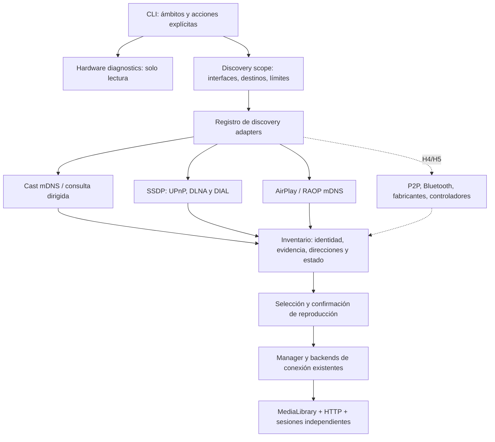

# H1 — Propuesta de arquitectura y frontera H2/H3

Actualización H4 (12-11-2026): se mantiene el diseño base descrito abajo. `p2p.py`/`wireless_bus.py` implementan adaptadores de descubrimiento radio explícitos; `wireless.py` gestiona el ciclo separado del scan IP; `wfd.py` aporta clasificación basada en anuncios. La UI funciona sin LAN IPv4. `miracast.py` prepara una integración externa y una presentación local, sin conexión Miracast activada. Véanse [investigación H4](H4_RESEARCH.md), [validación H4](H4_VALIDATION.md) y [ROADMAP](../../ROADMAP.md). La puerta H2/H3 se abrió mediante la nueva tarea H4; siguen pendientes validación física e instalación/cambios autorizados.

## Punto de partida inspeccionado

`script.py` contiene el menú y las funciones previas; `POLTERHEIST.py` importa `main`. TV Control es un paquete independiente con `Discovery`, `Endpoint`/`Device`, `Manager`/`Session`, `MediaLibrary`, `MediaServer` y dos backends de reproducción. Pruebas con unittest, formato/lint con Ruff y dependencias fijadas en `requirements.txt`. El directorio de trabajo ya contiene la implementación de la entrega anterior: se conserva, sin tratar esos cambios como descartables.

Limitaciones actuales relevantes: una interfaz IPv4, descubrimiento dirigido solo dentro de su subred, mezcla de descubrimiento y protocolo en algunos archivos, estados de inventario poco detallados y ausencia de diagnóstico global de hardware. El servidor HTTP actual sirve una dirección IPv4; anunciar una ruta enrutada no valida la ruta de retorno del contenido.

## Separación propuesta

H2 añade `hardware.py` sin depender de una interfaz LAN utilizable. H3 añade adaptadores registrables, resolución de alcance explícito, fuentes mDNS de AirPlay/RAOP y enriquecimiento de SSDP/DIAL. Los adaptadores producen observaciones; no invocan `connect`, `play`, pairing, StartFind, Bluetooth StartDiscovery ni cambios de interfaces.

## Contratos y evidencia

Una observación incluye protocolo, identificador con namespace, nombre/modelo anunciados, direcciones, puerto, fuente de descubrimiento, tiempo observado, evidencia de reachability y confianza. Un endpoint de control existente sigue siendo un `Endpoint`; sus campos adicionales no rompen los constructores actuales. No se marca controlable una integración solo investigada.

Los estados se muestran por dimensiones, porque no constituyen una escalera automática:

| Dimensión | Valores e interpretación |
| --- | --- |
| Descubrimiento | `DETECTED` o `UNAVAILABLE` tras actualización; solo evidencia observada. |
| Alcance | `NOT CHECKED`, `REACHABLE` por respuesta de protocolo o `UNREACHABLE`/error; nunca por nombre. |
| Compatibilidad | Backend implementado y requisitos anunciados, o `DISCOVERY ONLY`/`UNSUPPORTED`. |
| Autorización | Desconocida, anuncio de requisito o `PAIRING REQUIRED` solo con evidencia explícita. |
| Sesión | `CONNECTED`/`READY FOR MEDIA` solo cuando una sesión real informa conexión/reproducción aceptada. |
| Confianza | Anuncio, respuesta de protocolo, observación verificada localmente; incluye motivo, no porcentajes inventados. |

H3 mantiene IDs estables durante el proceso. Las asociaciones entre IPs/radios con identidad insuficiente no se fuerzan. La cache persistente, el ranking por calidad/latencia y la correlación radio inteligente son H7, no se implementan a escondidas en esta entrega.

## Alcance y límites de red

LAN conserva interfaz seleccionada y búsqueda multicast acotada. La búsqueda dirigida acepta direcciones IPv4, hostnames resueltos una vez y CIDR pequeños. Requiere confirmación del alcance, tiene máximo de hosts antes de expandir, concurrencia limitada y no prueba rangos de puertos. Se consulta Cast y SSDP unicast donde corresponda; un televisor puede no responder a uno de estos métodos.

Para un destino externo a la subred, la selección de IP origen se obtiene de la tabla de rutas sin modificarla. Las URLs de respuesta se restringen al literal del peer aprobado; no se siguen redirecciones ni se amplía el alcance por una descripción del dispositivo. Un hostname se fija a las direcciones resueltas para evitar cambios de destino entre validación y petición.

IPv6 es explícito en el modelo/diagnóstico y en direcciones DNS-SD observadas. La primera ampliación no convierte automáticamente el servidor de medios ni todos los transportes a IPv6. Los endpoints sin ruta multimedia implementada permanecen discovery-only. DNS-SD unicast y reflectores administrados están diseñados en H1, no instalados ni configurados en H3.

## H2: comprobaciones autorizadas

Consultar `iw dev/phy`, sysfs para IDs de chipset/controlador, `ip -j`, `nmcli` de estado, `wpa_cli get_capability`, propiedades D-Bus de wpa_supplicant, `rfkill` de estado, adaptadores/UUIDs BlueZ y herramientas multimedia. Comprobar encoders anunciados, plugins GStreamer, PipeWire y disponibilidad de portal de captura mediante propiedades, **sin iniciar captura**.

El runner utiliza argv, `shell=False`, tiempos máximos y límite de salida. Guarda estados/errores por comando; comandos desconocidos no entran en una cadena arbitraria. No usa sudo, no inicia servicios y no ejecuta escaneos de Wi-Fi/Bluetooth. Tener plugin H.264 no demuestra que el encoder hardware pueda abrir una sesión. Tener P2P no demuestra una negociación Miracast exitosa.

## Conexión, medios e integraciones posteriores

Se conserva el motor Cast/DLNA actual. Se exige confirmación antes de iniciar cualquier reproducción, incluida una sola TV, conforme a esta nueva tarea. Las nuevas observaciones AirPlay/RAOP/DIAL no adquieren controles ficticios. Los destinos enrutados requieren validar la ruta multimedia en una fase posterior antes de usar automáticamente el servidor actual.

H4 debería implementar descubrimiento P2P con un adaptador NM D-Bus y un ciclo explícito StartFind/StopFind, comprobando radio libre/coexistencia. El establecimiento del grupo y sus cambios del sistema se someterán a autorización concreta. Se propone evaluar GNOME Network Displays/FluxCast como procesos con contrato de inicio/estado/cancelación y versión fijada, no copiar un stack RTSP sin pruebas.

H5 añadirá controladores por fabricante y almacenamiento seguro de credenciales; H6 ampliará audio, RTSP/RTP y captura; H7 seleccionará rutas elegibles. Autenticación denegada es un resultado terminal de esa acción, no una señal para evitarla con otro backend.

## Plan de validación y puerta de revisión

Automatizar parsers de `iw`, sysfs simulado, herramientas ausentes/permisos/timeouts, mDNS AirPlay/RAOP y IPv6, XML DIAL, scopes hostname/CIDR, deduplicación y rechazo de URLs fuera de alcance. Los simuladores se identificarán como tales y solo usarán loopback. Ejecutar también las pruebas anteriores de sesiones y medios.

Entregar informe de diagnóstico con plataforma real, fuentes y limitaciones, y un registro de pruebas reproducible. En este workspace Windows solo se puede validar el comportamiento no-Linux y parsers/simuladores; las comprobaciones físicas de Kali y receptores quedan pendientes. **Después de entregar H2/H3, solicitar validación del usuario antes de H4 o de instalar dependencias importantes/cambiar configuraciones del sistema.**
